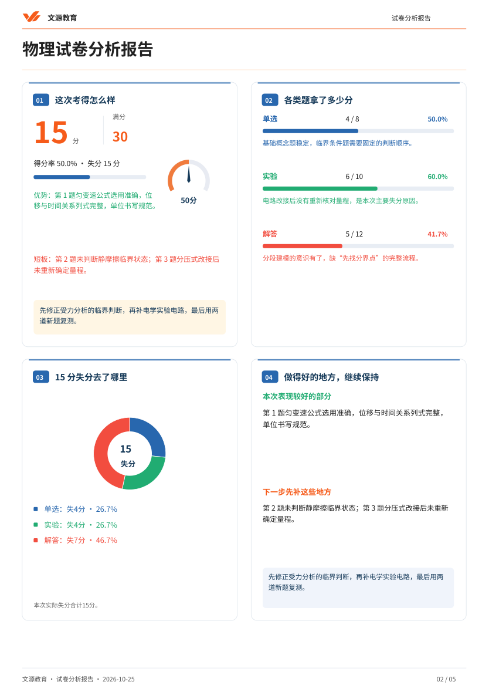

# 试卷分析 · Exam Analysis Studio

把一整份试卷变成一份可交付的**试卷分析报告**：逐题核对原始作答与得分、定位本轮优先问题、
写出错因与训练任务、排出三段复习，然后渲染成文源教育五页品牌 PDF。

这是 [`mistake-question-studio`](https://github.com/Yu-Jie-Chen/mistake-question-studio)
（错题整理）的姊妹 skill：那个把**一道错题**变成一张卡，这个把**一整份卷子**变成一份报告。



## 它替换了什么

教学工作台的「试卷分析」原来需要老师自己填视觉模型接口（Chat Completions 地址 + 模型 + Key），
浏览器把整份卷子发出去，拿回一份 JSON，再在编辑器里逐题改。

这个 skill 把"看卷、录题、写诊断"交给正在对话的模型，把**判断和签核**留给人：

| | 接口方式 | 这个 skill |
|---|---|---|
| 谁看卷 | 外部视觉模型，一次调用 | 逐页 PNG，一页一页看，看不清就留 `null` |
| 产出 | 编辑器里的草稿 | `draft.json` + 分析稿 + PDF |
| 改一次 | 重新调接口，整份重来 | 改 JSON 里那一条，重渲染 |
| 版式 | 工作台渲染 | 同一套渲染器（`vendor/` 逐字节复制） |

工作台仍然是校核、归档、进学生档案的地方；它不再负责"看卷"。

## 产出

```text
work/<id>/
├── source/            # 试卷、答题卡、答案原件
├── pages/             # 逐页 PNG，模型看这些
├── draft.json         # 唯一真源，工作台可直接导入
├── analysis.md/html   # 分析稿，给人校核
├── report.pdf         # 五页品牌报告（交付物）
├── review.md          # 校核记录
└── manifest.json      # 材料校验和
```

## 安装

```bat
pip install -r requirements.txt
```

`reportlab`、`python-docx`、`pypdfium2`、`PyMuPDF`。五页品牌报告要用 PyMuPDF 合成封面与页脚；
单页 / 两页 / 附录版只需要 reportlab。

`run.py` 会自动挑一个装好这些模块的 Python；想指定就加 `--python <路径>`，
或用环境变量 `EXAM_STUDIO_PYTHON`。

## 快速开始

```bat
python scripts\run.py new 试卷.pdf 答题卡.pdf 答案.pdf ^
  --student 王小明 --grade 高三 --subject 物理 ^
  --exam "高三第一次月考" --teacher 陈老师 --date 2026-10-25

python scripts\run.py pages  work\20261025-物理-王小明
python scripts\run.py check  work\20261025-物理-王小明
python scripts\run.py digest work\20261025-物理-王小明
python scripts\run.py approve work\20261025-物理-王小明 --all --reviewer 陈老师
python scripts\run.py render work\20261025-物理-王小明 --preview
```

一条命令到底：`python scripts\run.py finish work\<id>` → check + digest + render，只输出三行。

## 报告长什么样

| 页 | 内容 |
|---|---|
| 1 | 橙色流线品牌封面：学生、学校、年级、学科、考试、报告日期 |
| 2 | 得分 / 满分 / 得分率 / 仪表盘；各题型得分与点评；失分环形图；优势与短板 |
| 3 | 主要问题（≤4 题）；三段复习安排；老师沟通与家长配合 |
| 4+ | 附件：每题"原答 → 对照 → 参考结果 → 关键解法 → 训练 → 验收" |

硬约束：题型 ≤6 类；三类短摘要 ≤60 字；三段复习 ≤100 字；附件 ≤5 题。
超了渲染会直接报「文字超出最终模板区域」，按提示精简即可。

## 签核是人的动作

模型整理完，`reviewed` 全是 `false`。报告只统计**已校核**的分数，没签核的题按"待核"显示
（`已核 0/81 分`），不会把看不见的分数当成零分。老师看过 `analysis.html` 之后：

```bat
python scripts\run.py approve work\<id> --all --reviewer 陈老师
```

## 与教学工作台的关系

`vendor/` 里是教学工作台渲染器的**逐字节副本**（`standards.py`、`final_report.py`、
`compact_report.py`、`poster_report.py`、`delivery_reports.py` 与品牌素材）。
版式只有一处真源：工作台。改了工作台就同步回来：

```bat
python scripts\sync_engine.py --workbench "<教学工作台目录>"
python scripts\sync_engine.py --workbench "<教学工作台目录>" --check   # 只比对
```

**不要直接改 `vendor/`**——下次同步会覆盖。

## 目录

```text
SKILL.md              给模型看的路线图
references/           方法、字段口径、版式约束、质量门
scripts/              run.py 主入口 + 五个单脚本
vendor/               渲染器与品牌素材（来自教学工作台）
templates/            draft.json / question.json 骨架
examples/             虚构学生的完整示例
```

## 隐私

`work/` 在 `.gitignore` 里。示例用的是虚构学生"王小明"，没有真实学员信息。
报告不含班级排名、学号、家长手机号。

## 许可

代码供本机构内部使用，见 [LICENSE](LICENSE)。
`vendor/assets/` 下的字体按 SIL Open Font License 1.1 分发，见
[`vendor/assets/OFL.txt`](vendor/assets/OFL.txt)。
